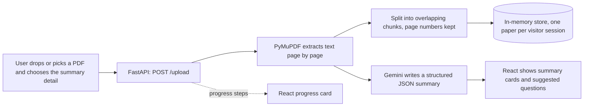
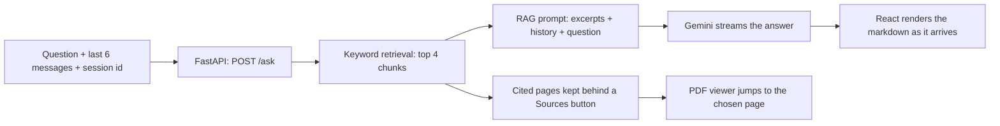

# Research Assistant for PDFs

A full-stack web app that turns a research paper into a structured summary and lets you chat with it, by typing or by voice. Upload a PDF, read the summary, and ask questions. Answers stream in as they are written, and the pages they came from are one click away in an embedded PDF viewer.

## Features

- **PDF upload** by file picker or drag and drop, with live progress steps (uploading, extracting text, splitting into sections, building the summary)
- **Summary detail selector:** Quick, Standard or Detailed, chosen before uploading
- **Structured summary** with Title and Authors, a short "In short" overview, Abstract, Problem Statement, Methodology, Key Results and Conclusion
- **Question answering chatbot** built on retrieval-augmented generation (RAG), answering only from the paper
- **Streaming answers:** text appears token by token, and the input is locked while an answer is being written
- **Rich answers:** markdown rendering, including tables and bullet lists
- **Hidden sources:** each answer has a Sources button that reveals the pages it used, and clicking a page jumps the PDF viewer to it
- **Conversation memory:** follow-up questions such as "and what are its limitations?" work
- **Suggested questions:** four tappable starter questions that are generated from the paper and answerable from it
- **Side-by-side PDF viewer:** shown on demand, with page up/down, a page number box and zoom controls
- **Voice conversation:** speak your question, hear the answer read aloud while the text is shown, then keep talking (Chrome or Edge)
- **Document info bar:** file name, page count, file size, estimated reading time and upload time
- **Graceful fallbacks:** a "Not found in this paper" state, clear errors for scanned, oversized or unreadable PDFs, and a friendly message when the AI is busy
- **Dark and light themes**, remembered between visits
- **Per-visitor papers:** every browser tab has its own session, so several people can use one server at the same time

## System architecture

**When a PDF is uploaded:**



**When a question is asked (typed or spoken):**



### How each stage works

1. **Parsing:** PyMuPDF reads the PDF and extracts the text of every page.
2. **Chunking:** each page is cut into chunks of about 1000 characters with 200 characters of overlap. Every chunk remembers its page number.
3. **Summary:** the text (up to 150,000 characters) goes to Gemini with a prompt that asks for JSON: a short overview, title, authors, the five sections and four suggested questions. The chosen detail level (Quick, Standard or Detailed) sets how long each section should be.
4. **Retrieval:** the question (together with the previous user question, so follow-ups still find the right text) is split into words, common words are removed, and each chunk is scored by how many of those words it contains. Rarer words count for more (a log-scaled, TF-IDF style weight). The top 4 chunks are kept.
5. **RAG prompt:** the 4 chunks, the last 6 messages of the conversation and the question go to Gemini. It is told to answer only from the excerpts, to format with markdown, to never mention page numbers in the text, and to start with `NOT_FOUND` when the paper does not cover the question.
6. **Streaming response:** the answer is sent back as newline-delimited JSON messages over a normal HTTP response: first the cited pages and whether the answer was found, then the text in pieces. The browser appends the pieces as they arrive.
7. **PDF viewer:** the PDF is displayed in the browser from the file you picked, using PDF.js, so the server does not need to store or send the PDF back.

### Why keyword retrieval and not embeddings?
Retrieval is kept lightweight on purpose: there is no vector database, no embedding model and no extra service to run, so the app starts with a single API key. The trade-off is that matching is based on shared words, not meaning. Swapping in embeddings with a vector index (for example FAISS or Chroma) is a natural next step, and the code is organised so only `backend/rag.py` would need to change.

## Tech stack

| Layer | Technology |
| --- | --- |
| Frontend | React (Vite), plain CSS, `react-markdown` with `remark-gfm` for answers, `pdfjs-dist` (PDF.js) for the PDF viewer |
| Backend | Python, FastAPI, Uvicorn |
| PDF parsing | PyMuPDF |
| LLM | Google Gemini API (`gemini-flash-lite-latest`, with `gemini-flash-latest` as a backup model) |
| Retrieval | In-memory chunk list with keyword scoring (`backend/rag.py`) |
| Voice | Browser Web Speech API (speech recognition and speech synthesis) |

**Reliability:** every Gemini call is retried up to 3 times with a short pause, then switches to the backup model. For streamed answers this applies until the first words arrive. If both models fail, the user sees a friendly "AI is busy" message.

## Project structure

```text
pdf-research-assistant/
├── backend/
│   ├── main.py            # FastAPI app: /upload, /ask, Gemini calls with retries, sessions
│   ├── rag.py             # Chunking and retrieval
│   ├── test_gemini.py     # Small script to check that your API key works
│   ├── requirements.txt
│   └── .env.example
├── frontend/
│   ├── src/
│   │   ├── App.jsx        # Start screen, summary, chat, upload progress
│   │   ├── PdfViewer.jsx  # PDF.js viewer with page and zoom controls
│   │   ├── Icons.jsx      # Small inline SVG icons
│   │   ├── useVoice.js    # Voice conversation logic
│   │   ├── App.css        # Layout and component styles
│   │   ├── index.css      # Theme colours and fonts
│   │   └── assets/logo.png
│   └── package.json
└── README.md
```

## API endpoints

| Method | Path | Purpose |
| --- | --- | --- |
| GET | `/` | Health check |
| POST | `/upload` | Multipart form: `file` (the PDF) and `depth` (`quick`, `standard` or `detailed`). Needs an `X-Session-Id` header. Streams progress messages, then the summary |
| POST | `/ask` | JSON body: `{ "question": "...", "history": [...] }`. Needs an `X-Session-Id` header. Streams `meta` (cited pages and whether the answer was found), then `token` messages with the text |

Interactive API docs are available at `http://127.0.0.1:8000/docs` while the backend is running. The upload and ask endpoints stream their responses, so the docs page shows them only after they finish.

## Setup and running locally

### Prerequisites

- **Python 3.10 or newer** (developed on 3.14)
- **Node.js 20 or newer** (developed on 24)
- **Git**
- A free **Gemini API key** from [Google AI Studio](https://aistudio.google.com) (click "Get API key")

### 1. Clone the repository

```bash
git clone https://github.com/Isla19/pdf-research-assistant.git
cd pdf-research-assistant
```

### 2. Set up and start the backend

```bash
cd backend
python -m venv venv
```

Activate the virtual environment:

- **Windows (PowerShell):** `venv\Scripts\Activate.ps1`
- **macOS / Linux:** `source venv/bin/activate`

(If PowerShell says scripts are disabled, run `Set-ExecutionPolicy -Scope CurrentUser RemoteSigned` once and try again.)

Install the packages:

```bash
pip install -r requirements.txt
```

Create your environment file. Copy `.env.example` to a new file named `.env` in the `backend` folder, then put your key in it:

```
GEMINI_API_KEY=paste-your-key-here
```

Start the server:

```bash
uvicorn main:app --reload
```

The backend now runs at `http://127.0.0.1:8000`. Keep this terminal open.

### 3. Set up and start the frontend

Open a **second terminal** in the project folder:

```bash
cd frontend
npm install
npm run dev
```

Open **http://localhost:5173** in **Chrome or Edge**.

### 4. Try it

1. Choose a summary detail, then drop a text-based research paper onto the upload card (or click it to pick a file).
2. Wait for the progress steps to finish (the summary step can take 10 to 30 seconds).
3. Read the summary, tap a suggested question or type your own, and click **Sources** under an answer to jump to the pages it used. Use **Show PDF** to open the PDF next to the summary and chat.
4. Click the microphone button, allow the microphone, and ask a question out loud.

## Configuration

| Setting | Where | Default |
| --- | --- | --- |
| `GEMINI_API_KEY` | `backend/.env` | none, required |
| `ALLOWED_ORIGINS` | backend environment variable, comma-separated websites allowed to call the API | `http://localhost:5173` |
| `VITE_API_URL` | frontend environment variable, read when the frontend is built or started | `http://127.0.0.1:8000` |
| `MODELS`, `MAX_CHARS`, `MAX_PAPERS` | top of `backend/main.py`: primary and backup model, characters sent for the summary, papers kept in memory | see the file |
| Upload limit | `backend/main.py` | 25 MB |
| Voice language and silence delay | `frontend/src/useVoice.js` (`rec.lang`, `SILENCE_MS`) | `en-GB`, 3.5 seconds |

Open the app with `localhost`, not `127.0.0.1`, because the backend only allows `http://localhost:5173` by default.

**Deployment:** the app is built to be deployable (configurable addresses and per-visitor sessions), but it is not deployed anywhere at the moment.

## Known limitations

- **Papers live in the server's memory,** one per browser tab, and the 20 most recent are kept. Restarting the backend clears them, and the app then asks the user to upload again.
- **Scanned PDFs** (images of text) are not supported because there is no OCR step. The app tells the user when a PDF has no readable text.
- **Retrieval is keyword-based,** so questions that use different words from the paper may retrieve weaker excerpts.
- **Citations point to pages,** not to the exact passage, and the viewer does not highlight text.
- **Suggested questions and answers depend on the AI model,** and can occasionally be imperfect. Answers are grounded in the retrieved excerpts, but should still be checked against the paper.
- **Voice** relies on the browser's speech recognition, which works in Chrome and Edge only and needs an internet connection. Accuracy depends on microphone, accent and background noise.
- **The Gemini free tier** has rate limits and can be busy at times. The app retries and falls back to a second model, but a very busy period can still cause an error message.
- The text of an uploaded PDF is sent to Google Gemini to generate the summary and answers, so avoid confidential documents.

## Troubleshooting

| Problem | What to do |
| --- | --- |
| "Cannot reach the server" | Make sure the backend is running on port 8000 |
| `uvicorn` not recognised | Activate the virtual environment first (see step 2) |
| "The AI is busy right now" | Wait a few seconds and try again |
| "I don't have a paper for this session" | The backend restarted. Upload the PDF again |
| Voice button missing, or nothing is heard | Use Chrome or Edge, allow the microphone, and check your input device |
| The PDF viewer says it cannot display the file | Try another PDF, and check the browser console for errors |
| Answers say the paper doesn't cover something it does | Rephrase using words from the paper |